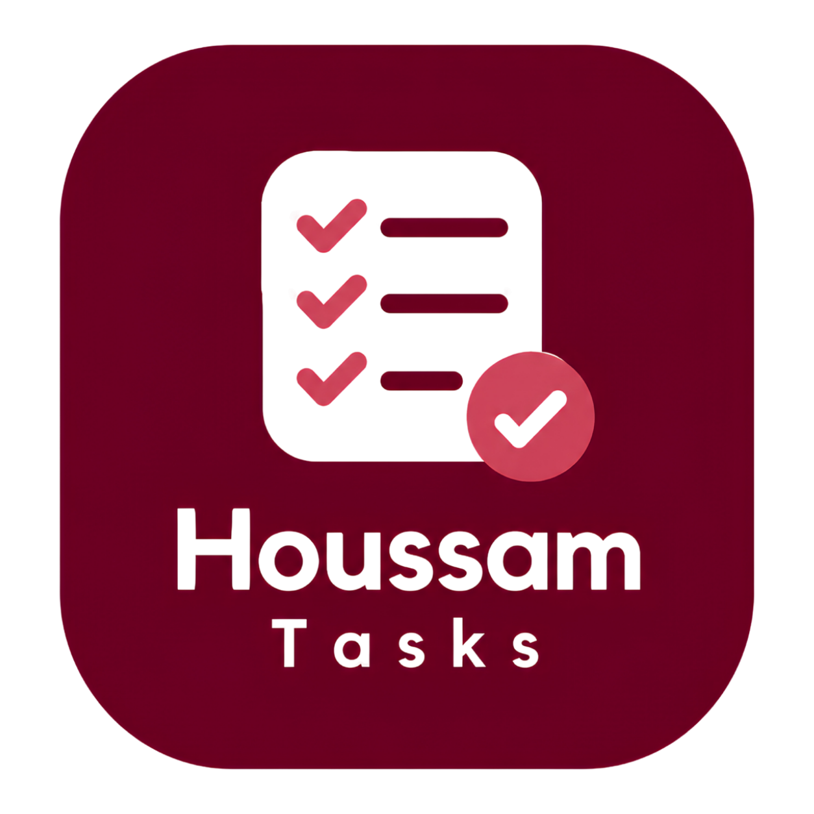

# HoussamTasks 🚀

> A Notion-style desktop task & project organizer built with **Electron, React 18, Vite, and SQLite (`sql.js`)**.



---

## 🌟 Overview

**HoussamTasks** is a lightweight, high-performance desktop productivity workspace designed around a bespoke brand palette (Burgundy `#800020`, Warm Cream `#F3E6D5`, Soft White `#FFF9F2`, and Coral Red `#D45060`).

Instead of rigid to-do lists, HoussamTasks provides **7 interchangeable views** powered by a single reactive dataset and local SQLite database:

| View | Purpose |
|---|---|
| 📋 **List View** | Structured tasks grouped by status (*To Do*, *In Progress*, *Done*), with inline editing, priority flags, tags, and animated checkmarks. |
| 📊 **Board (Kanban) View** | Drag-and-drop cards across workflow columns with color accents and quick-add actions. |
| 📑 **Table View** | Spreadsheet grid with inline cell editing, sorting by any property, and real-time filtering. |
| 📅 **Calendar View** | Interactive monthly grid showing tasks on their due dates with click-to-schedule. |
| 📈 **Timeline (Gantt) View** | Horizontal scrollable date axis with Day, Week, and Month zoom levels and duration bars. |
| 🖼️ **Gallery View** | Pinterest-style cards with color banner headers and note excerpt previews. |
| 🧠 **Mind Map View** | Radial brainstorming tree with smooth SVG bezier curves, draggable nodes, and pan/zoom controls. |

### Core Highlights:
- **Instant Auto-Save**: Debounced at 300ms — every edit, drag, or note is automatically saved to local SQLite (`houssam-tasks.db`).
- **Notion-Style Block Notes**: Rich task descriptions supporting Paragraphs, Headings (H1/H2/H3), Checklists, and Dividers.
- **Custom Frameless Title Bar**: Native Burgundy overlay with minimize, maximize, and close controls.
- **System Tray Support**: Minimizes quietly to the Windows system tray.
- **Global Keyboard Shortcuts**:
  - `Ctrl + K` : Global Command Palette & Search
  - `Ctrl + N` : New Task in active page
  - `Ctrl + Shift + N` : New Workspace Page
  - `Ctrl + \` : Toggle Sidebar
  - `Ctrl + 1` to `Ctrl + 7` : Switch view tabs instantly
  - `Esc` : Close any modal or detail drawer

---

## 💻 How to Clone & Run on Your PC (For You & Friends)

Follow these simple steps on any Windows PC:

### Step 1: Prerequisites
Make sure **Node.js** (v18 or higher) is installed on your computer.  
👉 Download from: [https://nodejs.org/](https://nodejs.org/)

### Step 2: Clone the Repository
```bash
git clone <YOUR_GIT_REPOSITORY_URL>
cd HoussamTasks
```

### Step 3: Install Dependencies
```powershell
npm install
```

### Step 4: Run the App in Development Mode (Optional)
If you want to run it from your code editor:
```powershell
npm start
```
*(or `npm run electron:dev` for live hot-reloading)*

---

## 🖥️ How to Put the App on Your Desktop (Double-Click Icon)

To get the app on your desktop so you can just **double-click the icon** anytime without opening any terminal or commands:

Run this one command in PowerShell:
```powershell
powershell -ExecutionPolicy Bypass -File .\create_shortcut.ps1
```

### What this does:
1. Automatically compiles and packages the production desktop executable (`HoussamTasks.exe`).
2. Generates a shortcut named **`HoussamTasks`** right on your **Windows Desktop** with the official brand icon.
3. Once completed, simply double-click the **HoussamTasks** icon on your Desktop to open your app!

---

## 📦 What to Push to Git

When sharing your repository, only push the source code and configuration.

---

## 🛠️ Tech Stack

- **Desktop Framework**: [Electron 33](https://www.electronjs.org/)
- **UI Framework**: [React 18](https://react.dev/)
- **Bundler**: [Vite 5](https://vitejs.dev/)
- **State Management**: [Zustand](https://github.com/pmndrs/zustand)
- **Database**: SQLite WebAssembly via [sql.js](https://sql.js.org/)
- **Drag & Drop**: [@dnd-kit](https://dndkit.com/)
- **Date Utilities**: [date-fns](https://date-fns.org/)
- **Typography & Styling**: Inter font, Vanilla CSS Custom Properties (Design Tokens)

---

## 📄 License
MIT License. Created by Houssam ELaasri 
houssamelaasri.contact@gmail.com


© 2024 Houssam ELaasri. All rights reserved.

